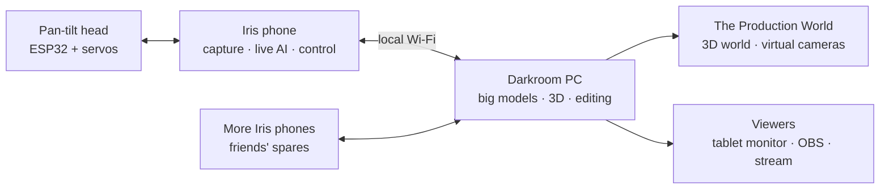

# Iris: a single-purpose AI camera (concept)

> Status: **concept, open for discussion.** First target: a spare **LG V30+** (Snapdragon 835). "Iris" is a working name. It applies the [Forge](../offline-ai-os/README.md) idea to one job: the device does nothing but take pictures, and all its intelligence goes into taking them well.

## The idea

A phone camera is one app among a hundred, built to please everyone, which means it hides its decisions and fights you when you want control. Iris turns the phone into **a camera and nothing else**:

- Switch it on and it is a camera. No home screen, no apps, no notifications, no accounts, no internet.
- **AI works for the photographer, not instead of them.** It reads the scene, suggests settings, tracks the subject and improves the image, but every decision it makes is visible and can be overridden.
- Everything runs on the device, offline.

## How "entirely new" can we go?

Everything the photographer touches will be new and ours. The lowest layers can't be, for hard physical reasons:

| Layer | Ours or reused | Why |
|---|---|---|
| Camera interface, controls, modes | **Ours, from scratch** | This is the product |
| AI features (scene reading, focus tracking, culling) | **Ours** (own models and logic; on-device inference library only) | This is the product |
| Image pipeline: RAW burst merging, noise reduction, tone mapping, colour | **Ours, from scratch** | Where the real photo quality comes from |
| Boot experience (device starts straight into Iris) | **Ours** | Makes it a camera, not a phone |
| Linux kernel, sensor drivers, Qualcomm image processor (ISP) firmware | **Reused** | The camera sensors and ISP are undocumented and closed. Writing these from zero isn't realistic. Without them the sensor produces no image at all |
| First-stage bootloader | **Reused** | Locked by Qualcomm's chain of trust; it can't be replaced on any phone |

So Iris is **new from the image upward**. That is also where every great camera brand differs. Sony, Fujifilm and Leica use similar sensors; what makes their cameras special is the processing and the handling.

## What the AI does

Two speeds, because the Snapdragon 835 is capable but not new.

**Live, while shooting** (small models on the GPU/DSP, fast enough for the viewfinder):
- **Scene reading:** detects backlight, low light, motion, faces and high contrast, then suggests exposure, ISO and shutter speed with a one-line reason ("subject backlit: +1 EV").
- **Subject tracking:** finds faces, eyes and animals, and keeps focus on them as they move.
- **Composition help:** horizon level from the gyroscope, and subtle framing hints. Off by default.
- **Lens advice:** "Scene too wide for the main lens, switch to wide?"
- **Shake and blur warning** before you press the shutter, using the motion sensors.

**After the shot** (heavier processing, a few seconds per photo, or in bulk while charging):
- **Burst merge:** every photo is secretly a burst of RAW frames, aligned and merged. That gives much cleaner low light and more dynamic range, the same principle behind Google's Night Sight.
- **Best-frame pick:** from a burst, choose the sharpest frame with eyes open.
- **Culling:** flag blurry, duplicate and badly exposed shots so you keep only good ones.
- **Smart denoise and sharpening** tuned to this specific sensor.
- **Tagging:** people, places and scenes, so photos can be searched offline.

**Rule (as in Aistro and Forge):** the AI advises and computes, the photographer decides. The original RAW is always kept, so nothing the AI does is destructive.

## Handling: a camera, not a phone

The V30+ has no shutter button, so the physical controls get new jobs:

| Control | Job |
|---|---|
| Volume down | Shutter (half-press style: tap to focus, hold to shoot a burst) |
| Volume up | Toggle between main and wide lens, or record video |
| Rear fingerprint sensor | **Swipe to change the active setting** (exposure, ISO, focus) like a control dial; touch to unlock the gallery so only the owner can see photos |
| Screen | Viewfinder first. Settings sit along the edges, reachable with one thumb |

(Fingerprint-as-dial depends on what the V30's sensor reports to software. If it only reports "touched", it becomes a second shutter or lock button.)

**Modes, kept few:**
- **Auto+**: AI picks settings and shows what it chose.
- **Manual**: full control; AI only shows a light meter and warnings.
- **Night**: long burst merge.
- **Video**: flat "log" colour profile for grading later, focus tracking, stabilisation from the gyroscope.
- **Scan**: documents and whiteboards, straightened and cleaned.

## Hardware: what the V30+ gives us
- **Main camera:** 16 MP, f/1.6, with optical stabilisation.
- **Wide camera:** 13 MP, 120°.
- Snapdragon 835: Adreno 540 GPU and Hexagon DSP for AI work; 4 GB RAM.
- 6" OLED (good viewfinder), microSD for storage, wireless charging.
- RAW capture and manual controls are available to software. That is why third-party camera apps already work well on this phone.

## With Wi-Fi: from camera to eye

Wi-Fi changes what Iris is. Offline, it is a camera. Connected to your own local network, it becomes **an eye**: a sensor that feeds a bigger brain. That brain is a PC with a GPU at home (the **Darkroom**) running models far bigger than the phone could. Nothing has to touch the internet; the network can be just your house.

### 1. Shoot once, direct forever (reality capture → The Production World)
Walk around a place or a person with Iris. It records video plus gyroscope and lens data and sends it to the Darkroom, which rebuilds the scene as a 3D model (Gaussian splatting, the technique behind apps like Luma and Polycam). That real place then loads into **The Production World**, where you put virtual cameras anywhere and shoot angles you never filmed: a crane shot, a slow orbit, a dolly through a doorway. Production World already makes the world first and treats every shot as a camera observing it. Iris makes that world from reality.

### 2. Robot camera operator
Mount Iris on a cheap pan-tilt head (an ESP32 board and two servos, a few hundred rupees) controlled over Wi-Fi. Iris tracks the subject and frames shots from a **shot list you describe in plain words**: "wide when I'm at the whiteboard, close-up when I talk to camera, slow push-in on the punchline." A solo creator gets a camera operator who never gets tired.

### 3. Swarm cinema
Collect two to six old phones from friends and family, put Iris on all of them, and they become **one synchronised multi-camera rig**. Clocks sync over Wi-Fi (fine-tuned with a clap or flash), the Darkroom aligns all angles, and an **AI editor cuts the multi-cam** like a TV director: who's speaking, who's reacting, where the action is. Tight sync allows "bullet-time" style frozen moments across all phones. Old phones stop being e-waste and become a film crew.

### 4. The camera that learns your eye
Every keep, delete and edit you make teaches a **personal style model** trained on the Darkroom overnight. Iris starts developing photos the way you would, and while you shoot it quietly flags "this looks like the shots you love". Over months, the camera becomes yours in a way no factory camera can.

### 5. What-if, for real footage
Production World has "what if" branches. Apply them to real captured scenes: with the 3D capture and generative video on the Darkroom, re-render the same street *at night*, *in rain*, *ten years later*, with the geometry and camera moves staying consistent because they come from the real capture.

### 6. A living portrait of a place
Leave Iris at a window, a garden, a construction site or a shop for months. It shoots a time-lapse and the AI keeps a diary of what happened: "first flower opened", "bird visited 14 times today", "third floor slab poured". Search it later by asking ("show me every time the cat was on the wall"). A camera that remembers instead of just recording.

### 7. Live production studio in your pocket
Iris streams to OBS or a browser on the local network and acts as a **two-camera crew by itself**: main lens for the close-up, wide lens for the room, AI switching between them, auto-framing, live captions. Add more Iris phones and it becomes a full streaming studio.

### 8. Wireless field monitor and remote
A director, client or friend watches the live feed on a tablet, taps to set focus, leaves voice notes timestamped on the footage, and approves takes. Footage starts uploading to the Darkroom the moment the take ends, so editing can start before the shoot is over.

### 9. Turn objects into game assets
Put an object on a turntable (or a cheap motorised one controlled by Iris over Wi-Fi). Iris shoots it from every angle and the Darkroom builds a clean, textured 3D model ready for a game engine or Production World. Your room becomes a 3D scanning studio.

### What runs where
| On the phone (Snapdragon 835, 4 GB) | On the Darkroom PC (GPU) |
|---|---|
| Capture, RAW bursts, gyroscope data | 3D reconstruction (Gaussian splats) |
| Live tracking, framing, scene reading | Generative "what-if" video |
| Controlling the pan-tilt head and turntable | Personal style model training |
| Streaming and syncing with other Iris phones | Multi-cam AI editing, heavy denoise and upscaling |

**Privacy stays the same:** the network is yours. Internet is a separate switch, off by default.

## Build plan

| Phase | What | Risk to the phone |
|---|---|---|
| 1 | **Our own camera app**, written from scratch: RAW capture, manual controls, our button mapping | None |
| 2 | **Lock it down as a dedicated camera:** factory reset, then set Iris as the device owner in "kiosk" mode, so the phone boots straight into Iris and nothing else can run | None (reversible with a factory reset) |
| 3 | **Our image pipeline**: burst merge, tone mapping, denoise | None |
| 4 | **AI features**: scene reading, subject tracking, culling, best-frame pick | None |
| 5 | Optional: unlock the bootloader and build a **minimal system image containing only Iris**, with everything else stripped out | Medium (unlock can brick; see XDA V30 threads) |

Phases 1–4 deliver the full experience on the phone's original, factory-tuned camera drivers, so photo quality starts as high as possible. Phase 5 is about purity, not image quality, and can wait.

## Open questions
1. **Photos or video first?** Both are possible, but each needs different tuning and AI.
2. **How much AI by default?** Auto+ as the default, or open in Manual?
3. **How do photos leave the camera?** microSD card only (true offline), USB to a PC, or local Wi-Fi to a phone/PC when you choose?
4. **Which Wi-Fi feature first?** Recommended: reality capture into The Production World, since it connects Iris directly to an existing project.
5. **Look and style:** a specific colour "look" of our own (like Fujifilm's film simulations), or neutral?
