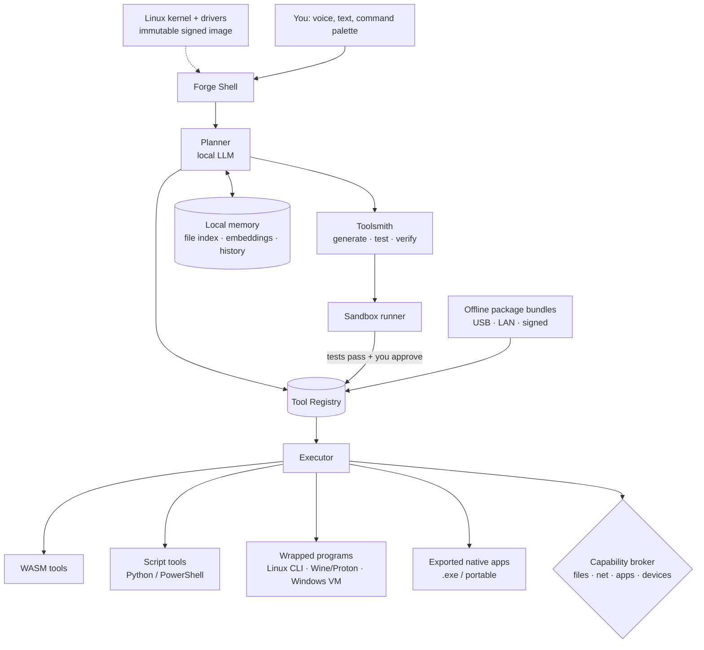

# Forge: an offline AI operating system (concept)

> Status: **concept, open for discussion.** Nothing here is built yet. "Forge" is a working name.

## The hidden assumption

Today's computers rest on two assumptions:

1. **Software is a fixed thing you download.** Someone else decided what the app does. If it doesn't do what you need, you look for another app.
2. **Intelligence lives in the cloud.** The useful AI is a remote service: it needs a connection, an account and a subscription, and it sees your data.

Forge flips both. The device carries its own model, and that model's main job is not to chat. **Its job is to make and run tools.** When you need something your computer can't do, you describe it, and Forge either finds an existing tool, wraps an installed program, or writes a new one, tests it and installs it. All of this works with the network cable unplugged.

## The core rule: the model is the toolsmith, not the tool

A small local model is slow, sometimes wrong and non-deterministic. So it should not sit in the middle of every task. Instead:

- The model **writes** a tool once (code, tests, manifest).
- The tool **runs** as ordinary, deterministic code: fast, repeatable, inspectable, and usable without the model at all.
- The model is called again only to **compose** tools, **explain** results or **repair** a tool that failed.

This is the same pattern as Aistro's narration guardrail: the engine computes the facts, the AI only works on top of them. A tool that renames 3,000 photos by date should be a 40-line script you can read, not 3,000 model calls.

## What it is (and isn't)

**Decision: Forge is an independent system.** It boots on its own, owns the whole machine, and does not need Windows, macOS, an account or the internet to work. You switch it on and you are in Forge.

| It is | It isn't |
|---|---|
| A **complete operating system** that boots straight into the Forge shell | An app or layer running on top of Windows |
| **Offline by default**; the network is a permission like any other | A thin client for a cloud model |
| A **tool registry + toolsmith + sandbox** with a chat/command interface | Just a chatbot with file access |
| Able to **export** what it builds as normal Windows, Linux and web programs | A walled garden where tools only work inside Forge |
| Built on a **proven open-source kernel (Linux)** | A from-scratch kernel |

### Independent, but not from scratch
Writing a kernel and drivers from zero would take years and add nothing users would notice. Every successful single-purpose OS reuses one: **SteamOS** (Steam Deck), **ChromeOS** and Android all run on Linux. Forge does the same:

- **Linux kernel and drivers** handle hardware, power, Wi-Fi, displays and storage.
- **Everything above that is Forge:** the shell, the model runtime, the tool system, the permissions, the interface. There is no general desktop underneath to fall back to; Forge *is* the desktop.
- **Immutable system image.** The OS is read-only and updated as a whole, signed image (A/B partitions, so a failed update rolls back automatically). Your tools and data live separately and survive updates.
- **Supported hardware list.** Like the Steam Deck, Forge targets a small set of devices it is tested on, so drivers, NPU/GPU acceleration and battery life are reliable rather than "maybe".

### Windows compatibility without Windows
People still have Windows programs and files. Forge handles them from the outside:
- **Run some Windows apps** through a compatibility layer (Wine/Proton, the same approach SteamOS uses to run Windows games).
- **Optional Windows VM** for software that only works on real Windows, as a sandboxed tool that you install only if you need it.
- **Export tools as .exe**, so anything built in Forge can be handed to someone who uses Windows.

## Architecture



### 1. Local model runtime
- Runs open-weight models fully on-device via llama.cpp / ONNX Runtime / Vulkan, using NPU or GPU when present, CPU otherwise.
- Two roles, possibly two models: a **small fast model** for planning and routing, and a **larger code model** for tool generation, loaded only when needed.
- Model files are just files: swap, update or roll back from a USB stick.

**Hardware tiers (rough):**

| Tier | Machine | What works |
|---|---|---|
| Lite | 8 GB RAM, CPU only | ~1–3B quantized model. Routing, running and composing existing tools; simple script generation. |
| Standard | 16 GB RAM, iGPU/NPU | ~7–8B quantized. Reliable script tools, small GUIs, file and document work. |
| Pro | 32 GB+, discrete GPU | 14B+ code model. Multi-file tools, generated UIs, repair loops. |

### 2. Tool registry and manifest
Every tool, whether installed, wrapped or generated, is described by one manifest:

```yaml
id: photo-renamer
version: 1.2.0
origin: generated            # generated | bundle | wrapped-app
runtime: wasm                # wasm | python | powershell | native | wrapped
entry: main.wasm
description: Rename photos by EXIF date into YYYY-MM-DD_HHMMSS.jpg
inputs:
  folder: { type: path, kind: directory }
  dry_run: { type: bool, default: true }
outputs:
  report: { type: table }
capabilities:
  - fs.read:  "{inputs.folder}"
  - fs.write: "{inputs.folder}"
  # no network, no other folders
tests: tests/                # generated alongside the tool, must pass to install
provenance:
  prompt: "rename my holiday photos by the date they were taken"
  model: <local model id + hash>
  created: 2026-10-12
```

The manifest is what makes tools **composable** (typed inputs/outputs the planner can chain), **safe** (capabilities are declared up front) and **portable** (a tool plus its manifest is a self-contained bundle).

### 3. The Toolsmith loop
How a new tool gets made:

1. **Clarify.** The planner turns your request into a short spec and asks only the questions that change the result ("Overwrite originals or copy?").
2. **Search first.** Check the registry and installed programs. Reuse beats generation.
3. **Generate.** Code model writes the tool, its manifest and its tests. It is shown a few existing tools as style examples.
4. **Run in sandbox.** Tests run against sample/dummy data with no real file access.
5. **Repair.** On failure, the error goes back to the model; capped retries.
6. **Review.** You see a plain-language summary, the permissions requested, a dry-run preview, and the code if you want it.
7. **Install.** Tool is versioned in the registry. Every later change is a new version with one-click rollback.

### 4. Execution and sandboxing
Generated code is treated as **untrusted**, always.

- **WASM/WASI** is the default target for generated tools: portable, no ambient access, capabilities granted per run.
- **Python/shell** tools run in a restricted container (namespaces, seccomp, bubblewrap-style isolation) with only the declared folders mounted. Owning the whole OS makes this stronger than it could be as an app on someone else's system.
- **Native and wrapped apps** go through the capability broker, which mediates every file, network and device access and logs it.
- **Network is off by default.** A tool that wants it must declare it, and you approve it per tool.

### 5. Working with existing software (both directions)

**Bring programs in.** Forge can wrap existing software as tools:
- **Command-line programs** (ffmpeg, git, ImageMagick, pandoc, Python libraries): the model writes the manifest and argument mapping.
- **Open-source desktop apps** (LibreOffice, Blender, GIMP, Kdenlive) through their scripting interfaces.
- **Windows programs** via Wine/Proton, or inside the optional Windows VM for those that need real Windows.
- **Offline packages** from a local cache or USB bundle, installed and registered like any other tool.

**Send tools out.** Anything Forge builds can be exported as an ordinary program:
- a standalone **Windows .exe**, Linux binary or portable folder (generated UI + bundled runtime),
- a **single-file web app** that runs in any browser,
- a **Python or shell script** with a README.

Exported tools don't need Forge or the model to run. You can give one to a colleague who has never heard of Forge.

### 6. Local memory
- A local index of your files (text, PDFs, images via local captioning) with embeddings, so "the invoice from the plumber last spring" resolves to a file.
- Tool usage history, so the planner learns which tools you prefer.
- Stored encrypted on the device; nothing leaves it. Easy to inspect and wipe.

### 7. Offline distribution
Without an app store or internet, tools and models move as **signed bundles**:
- copy over USB, sync over the local network between Forge devices, or pull from a shared folder;
- each bundle carries its manifest, tests and signature; Forge re-runs the tests before installing;
- organisations (schools, clinics, offices with no reliable connection) can curate a local "shelf" of approved tools.

## Interface ideas
- **Command palette** (Win+Space style): type intent, get either a matching tool or "Build a tool for this?"
- **Generated UIs**: a tool's input form is generated from its manifest; richer tools get a small generated window.
- **Chat panel** for the back-and-forth of clarifying and reviewing.
- **Pipelines view**: chain tools visually (scan folder → OCR → extract totals → spreadsheet), save the chain as a new tool.

## Example sessions

**"Every Friday, collect the PDFs in Downloads that look like invoices, pull out vendor, date and total, and add them to my expenses sheet."**
→ Forge finds an existing PDF-text tool, generates a small invoice-field extractor with tests, writes the rows into your .xlsx expenses sheet, chains them, and offers to schedule the chain. Runs every Friday with no model calls unless an invoice doesn't parse.

**"I need a tiny app to track which of my neighbours borrowed which tools."**
→ Generates a small local app (SQLite + simple window), installs it, and offers to export it as a standalone .exe or web app.

**"Convert all these .mkv files so they play on my TV."**
→ Detects ffmpeg is installed, wraps it, asks one question (keep originals?), shows a dry run, runs it.

## Why offline matters
- **Privacy:** your files never leave the device; nothing to leak, subpoena or train on.
- **Access:** works in villages, ships, field sites, secure facilities, flights.
- **Cost:** no per-token bill; the hardware you own is the whole cost.
- **Durability:** tools you built keep working if a company shuts down a service.

## Product line: task editions

Rather than one general device, Forge can ship as **editions tuned for a kind of work**. The pitch is simple: *you pay once for the device, not every month for tokens.*

### What an edition is
Every edition runs the same Forge core. What changes is the bundle on top:

**Edition = hardware spec + model pack + tool shelf + interface preset**

| Part | What it means |
|---|---|
| Hardware spec | RAM, GPU/NPU and storage sized for that work, and no more |
| Model pack | Models chosen for the job (a code model for analysts, speech and vision models for creators) |
| Tool shelf | Tested tools preinstalled, so day one is useful without generating anything |
| Interface preset | Home screen, shortcuts and templates for that profession |

Because editions share one core, an edition is **a pack, not a lock**. A Business Book owner could add the Creator pack later if the hardware can handle it.

### Proposed editions

| | **Forge Business Book** | **Forge Creator Studio** |
|---|---|---|
| For | Analysts, small-business owners, developers, finance and ops people | YouTubers, editors, social-media teams, podcasters |
| Form | Laptop | Mini-PC / desktop (needs cooling and storage) |
| Hardware (rough) | 32 GB RAM, NPU or mid GPU, 1 TB SSD | 32–64 GB RAM, strong GPU (12–16 GB+ VRAM), 2–4 TB fast storage |
| Model pack | Code model (~14B), small router model, document/table understanding | Speech-to-text, captioning and translation, vision models for scene detection and tagging, image generation and upscaling |
| Tool shelf | Spreadsheet cleaning and merging, SQL over local files, charts and dashboards, report and slide generation, invoice/receipt extraction, Python/JS coding assistant with local test running | Auto-transcribe and subtitle, cut silences and filler words, find the best clips, B-roll search across your own library, thumbnail drafts, audio cleanup, batch export per platform (Shorts, Reels, YouTube) |
| Wraps | LibreOffice (opens and saves Excel files), VS Code, git, Python, databases | ffmpeg, DaVinci Resolve (has a Linux version), Kdenlive, Blender, OBS |
| Fit with local AI today | **Strong.** Code and data are where small local models are best, and results can be checked (tests pass, numbers reconcile) | **Good for assist, limited for generation.** Transcribing, cutting, tagging and captioning work well locally; generating full-quality video on-device is still slow and lower quality than cloud |
| Price position | Mid | Premium |

### Further editions to consider
- **Forge Counsel**: lawyers, doctors and accountants, where privacy is the main reason to buy. Document review, drafting and search over confidential files that legally shouldn't go to a cloud.
- **Forge Field**: clinics, schools and NGOs in low-connectivity areas. Rugged and low-power, with local-language models and an offline tool shelf curated by the organisation.
- **Forge Student**: a low-cost Lite tier for learning to code and write, with tutoring that works without internet.

### The economics, honestly
- **Upfront vs monthly.** An edition costs more upfront than an ordinary laptop (more RAM, a better GPU/NPU). For someone paying for one or more AI subscriptions plus usage-based API costs every month, that premium can pay for itself within a year or two. For a light user it may never pay back.
- **Cloud keeps getting cheaper.** "No tokens" alone is a weak moat if cloud prices keep falling. The stronger reasons to buy are **privacy, working offline, owning your tools, and a fixed, predictable cost**. Lead with those; savings are a bonus.
- **Hardware is expensive to start.** Designing and stocking a device ties up a lot of capital. Because Forge is its own OS, it doesn't need custom hardware on day one: it can be **installed on a short list of tested off-the-shelf laptops and mini-PCs**, wiping whatever was there, and sold preinstalled through a PC maker. A custom Forge device follows once one edition has proven demand.
- **Recurring revenue without tokens.** Optional paid model-pack and tool-shelf updates, business tool shelves for a team, and support contracts for organisations.

### Which edition first
**Business Book.** It is the best match between what small local models do well (code, data, documents) and what people will pay for. It runs on hardware that is already common, and its output can be verified, which keeps trust high. Creator Studio is the more exciting demo, but it needs heavier hardware and the gap with cloud tools is wider today.

## Risks and honest limits
- **Small models write worse code.** Mitigated by tests-before-install, reuse-before-generate, narrow tool scope and repair loops, but complex software is out of reach on Lite hardware.
- **Generated code is a security surface.** The sandbox and capability broker are not optional; they are the product.
- **Drivers and hardware support.** Owning the OS means owning driver problems: Wi-Fi, sleep, NPUs and new GPUs. A strict supported-hardware list is essential.
- **Windows apps won't all work.** Wine/Proton covers many programs but not all (especially some Office features and anti-cheat or DRM software). The VM fallback costs RAM and battery.
- **Users must leave Windows.** Switching OS is a big ask. Editions help: the device is sold as a work tool, not as "a new OS to learn".
- **Tool sprawl.** Hundreds of near-duplicate tools. Needs dedup, merging and "you have a tool for this already".
- **Updates without internet.** Model and security updates rely on bundles; stale models on air-gapped machines is a real concern.
- **Battery and heat** on laptops when the code model runs.

## Roadmap sketch

| Phase | Deliverable | Proves |
|---|---|---|
| 0 | Prototype on Linux: local model + manifest format + registry + Python tools in a sandbox | The toolsmith loop works offline on a 16 GB laptop |
| 1 | **Bootable Forge image** (USB) that starts directly into the Forge shell on 2–3 tested laptops; tests-before-install; versioning and rollback | It runs as an independent system |
| 2 | WASM runtime; capability broker; export to .exe and web; pipelines; Wine/Proton for Windows programs | It is safe, and work moves in and out of Forge |
| 3 | Immutable A/B images with signed offline updates; local memory/index; signed tool bundles; LAN sync | It can be maintained without internet |
| 4 | First edition (Business Book) preinstalled on tested off-the-shelf laptops | People will pay for a task-tuned offline device |
| 5 | Creator Studio and other editions; OEM partnership or custom Forge hardware | A full device line |

A good first demo: boot a laptop from a Forge USB stick with no internet, ask for a tool that doesn't exist, watch it get written, tested, permission-checked and installed, then export it as an .exe that runs on a Windows PC, all in a few minutes.

## Open questions (for discussion)
1. ~~**Layer or OS?**~~ **Decided: an independent OS** on the Linux kernel. Still open: which base to start from (a minimal custom build, or an existing immutable distro such as Fedora Atomic or NixOS)?
2. **Which language should generated tools target?** Python is easiest for models to write; WASM is safest to run. Python compiled/run under a WASM runtime might give both.
3. **How much should the user see?** Always show code, or only on request? Who is the target user: power users or people who never want to see code?
4. **Trust model for shared bundles.** Signatures from whom? A local organisation key? Web-of-trust between devices?
5. **One model or two?** A single mid-size model is simpler; a router + code model split is faster on weak hardware.
6. **Should tools be able to call the model at run time?** Some tasks (summarise, classify) genuinely need it. Allow it as a declared capability (`llm.call`) with limits?
7. **Optional online mode?** Strictly offline as a principle, or allow an opt-in cloud model for hard generation tasks, clearly marked?
8. **Hardware target:** existing PCs only, or a dedicated "Forge box" device?
9. **Edition boundaries:** split by profession (analyst, creator, lawyer) or by workload (documents, media, code)? Professions sell more clearly; workloads overlap less.
10. **Own hardware, or Forge preinstalled on tested off-the-shelf machines first?** Custom hardware gives the most control; preinstalling on existing machines is far cheaper to start.
11. **How much Windows compatibility is enough?** Wine/Proton only, or ship the optional Windows VM (which raises licensing questions)?

---
*Concept by Abhishek Nimesh. Feedback and disagreement welcome.*
