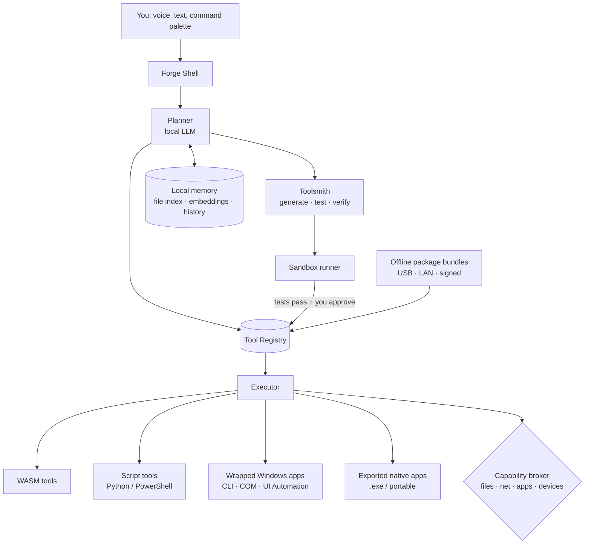

# Forge: an offline AI operating layer (concept)

> Status: **concept, open for discussion.** Nothing here is built yet. "Forge" is a working name.

## The hidden assumption

Today's computers rest on two assumptions:

1. **Software is a fixed thing you download.** Someone else decided what the app does. If it doesn't do what you need, you look for another app.
2. **Intelligence lives in the cloud.** The useful AI is a remote service: it needs a connection, an account and a subscription, and it sees your data.

Forge flips both. The device carries its own model, and that model's main job is not to chat. **Its job is to make and run tools.** When you need something your computer can't do, you describe it, and Forge either finds an existing tool, wraps an installed program, or writes a new one, tests it and installs it. All of this works with the network cable unplugged.

## The core rule: the model is the toolsmith, not the tool

A small local model is slow, sometimes wrong and non-deterministic. So it should not sit in the middle of every task. Instead:

- The model **writes** a tool once (code, tests, manifest).
- The tool **runs** as ordinary, deterministic code: fast, repeatable, inspectable, and usable without the model at all.
- The model is called again only to **compose** tools, **explain** results or **repair** a tool that failed.

This is the same pattern as Aistro's narration guardrail: the engine computes the facts, the AI only works on top of them. A tool that renames 3,000 photos by date should be a 40-line script you can read, not 3,000 model calls.

## What it is (and isn't)

| It is | It isn't |
|---|---|
| An **AI layer that runs on top of Windows** (later Linux/macOS) | A new kernel or a replacement for Windows, at least not at first |
| **Offline by default**; the network is a permission like any other | A thin client for a cloud model |
| A **tool registry + toolsmith + sandbox** with a chat/command interface | Just a chatbot with file access |
| Able to **export** what it builds as normal Windows programs | A walled garden where tools only work inside Forge |

Starting as a layer is a deliberate choice: Windows already handles drivers, hardware, windows and existing apps. Forge earns its keep in the part Windows doesn't do: turning intent into working software. A bootable "Forge OS" (a minimal Linux image with Forge as the shell) is a later option, discussed below.

## Architecture



### 1. Local model runtime
- Runs open-weight models fully on-device via llama.cpp / ONNX Runtime (DirectML on Windows), using NPU or GPU when present, CPU otherwise.
- Two roles, possibly two models: a **small fast model** for planning and routing, and a **larger code model** for tool generation, loaded only when needed.
- Model files are just files: swap, update or roll back from a USB stick.

**Hardware tiers (rough):**

| Tier | Machine | What works |
|---|---|---|
| Lite | 8 GB RAM, CPU only | ~1–3B quantized model. Routing, running and composing existing tools; simple script generation. |
| Standard | 16 GB RAM, iGPU/NPU | ~7–8B quantized. Reliable script tools, small GUIs, file and document work. |
| Pro | 32 GB+, discrete GPU | 14B+ code model. Multi-file tools, generated UIs, repair loops. |

### 2. Tool registry and manifest
Every tool, whether installed, wrapped or generated, is described by one manifest:

```yaml
id: photo-renamer
version: 1.2.0
origin: generated            # generated | bundle | wrapped-app
runtime: wasm                # wasm | python | powershell | native | wrapped
entry: main.wasm
description: Rename photos by EXIF date into YYYY-MM-DD_HHMMSS.jpg
inputs:
  folder: { type: path, kind: directory }
  dry_run: { type: bool, default: true }
outputs:
  report: { type: table }
capabilities:
  - fs.read:  "{inputs.folder}"
  - fs.write: "{inputs.folder}"
  # no network, no other folders
tests: tests/                # generated alongside the tool, must pass to install
provenance:
  prompt: "rename my holiday photos by the date they were taken"
  model: <local model id + hash>
  created: 2026-10-12
```

The manifest is what makes tools **composable** (typed inputs/outputs the planner can chain), **safe** (capabilities are declared up front) and **portable** (a tool plus its manifest is a self-contained bundle).

### 3. The Toolsmith loop
How a new tool gets made:

1. **Clarify.** The planner turns your request into a short spec and asks only the questions that change the result ("Overwrite originals or copy?").
2. **Search first.** Check the registry and installed Windows apps. Reuse beats generation.
3. **Generate.** Code model writes the tool, its manifest and its tests. It is shown a few existing tools as style examples.
4. **Run in sandbox.** Tests run against sample/dummy data with no real file access.
5. **Repair.** On failure, the error goes back to the model; capped retries.
6. **Review.** You see a plain-language summary, the permissions requested, a dry-run preview, and the code if you want it.
7. **Install.** Tool is versioned in the registry. Every later change is a new version with one-click rollback.

### 4. Execution and sandboxing
Generated code is treated as **untrusted**, always.

- **WASM/WASI** is the default target for generated tools: portable, no ambient access, capabilities granted per run.
- **Python/PowerShell** tools run in a restricted environment (Windows AppContainer / job objects; firejail/bubblewrap on Linux) with only the declared folders mounted.
- **Native and wrapped apps** go through the capability broker, which mediates every file, network and device access and logs it.
- **Network is off by default.** A tool that wants it must declare it, and you approve it per tool.

### 5. Working with normal Windows (both directions)

**Bring Windows apps in.** Forge can wrap software already on the machine as tools:
- **CLI programs** (ffmpeg, git, 7-Zip, ImageMagick): the model writes the manifest and argument mapping.
- **Office and other COM-scriptable apps**: drive Excel, Word or Outlook through their automation interfaces.
- **Anything else** via Windows UI Automation, as a last resort, since it's fragile.
- **Offline installers** (.msi/.exe/winget packages from a local cache) can be installed and registered.

**Send tools out.** Anything Forge builds can be exported as an ordinary program:
- a standalone **.exe** or portable folder (generated UI + bundled runtime),
- a **PowerShell/Python script** with a README,
- a **right-click context-menu action** or a scheduled task.

Exported tools don't need Forge or the model to run. You can give one to a colleague who has never heard of Forge.

### 6. Local memory
- A local index of your files (text, PDFs, images via local captioning) with embeddings, so "the invoice from the plumber last spring" resolves to a file.
- Tool usage history, so the planner learns which tools you prefer.
- Stored encrypted on the device; nothing leaves it. Easy to inspect and wipe.

### 7. Offline distribution
Without an app store or internet, tools and models move as **signed bundles**:
- copy over USB, sync over the local network between Forge devices, or pull from a shared folder;
- each bundle carries its manifest, tests and signature; Forge re-runs the tests before installing;
- organisations (schools, clinics, offices with no reliable connection) can curate a local "shelf" of approved tools.

## Interface ideas
- **Command palette** (Win+Space style): type intent, get either a matching tool or "Build a tool for this?"
- **Generated UIs**: a tool's input form is generated from its manifest; richer tools get a small generated window.
- **Chat panel** for the back-and-forth of clarifying and reviewing.
- **Pipelines view**: chain tools visually (scan folder → OCR → extract totals → spreadsheet), save the chain as a new tool.

## Example sessions

**"Every Friday, collect the PDFs in Downloads that look like invoices, pull out vendor, date and total, and add them to my expenses sheet."**
→ Forge finds an existing PDF-text tool, generates a small invoice-field extractor with tests, wraps Excel via COM, chains them, and offers to schedule the chain. Runs every Friday with no model calls unless an invoice doesn't parse.

**"I need a tiny app to track which of my neighbours borrowed which tools."**
→ Generates a small local app (SQLite + simple window), installs it, and offers to export it as a standalone .exe.

**"Convert all these .mkv files so they play on my TV."**
→ Detects ffmpeg is installed, wraps it, asks one question (keep originals?), shows a dry run, runs it.

## Why offline matters
- **Privacy:** your files never leave the device; nothing to leak, subpoena or train on.
- **Access:** works in villages, ships, field sites, secure facilities, flights.
- **Cost:** no per-token bill; the hardware you own is the whole cost.
- **Durability:** tools you built keep working if a company shuts down a service.

## Risks and honest limits
- **Small models write worse code.** Mitigated by tests-before-install, reuse-before-generate, narrow tool scope and repair loops, but complex software is out of reach on Lite hardware.
- **Generated code is a security surface.** The sandbox and capability broker are not optional; they are the product.
- **Windows UI Automation is brittle.** Prefer CLI/COM; treat UI automation as best-effort.
- **Tool sprawl.** Hundreds of near-duplicate tools. Needs dedup, merging and "you have a tool for this already".
- **Updates without internet.** Model and security updates rely on bundles; stale models on air-gapped machines is a real concern.
- **Battery and heat** on laptops when the code model runs.

## Roadmap sketch

| Phase | Deliverable | Proves |
|---|---|---|
| 0 | CLI prototype: local model + manifest format + registry + Python tools in a basic sandbox | The toolsmith loop works offline on a 16 GB laptop |
| 1 | Command palette app on Windows; wrap CLI apps; tests-before-install; versioning and rollback | It is useful day to day |
| 2 | WASM runtime; capability broker; export to .exe; pipelines | It is safe and tools escape Forge |
| 3 | Local memory/index; signed offline bundles; LAN sync | It works for a group with no internet |
| 4 | Optional bootable Forge image (minimal Linux + Forge shell) for dedicated or donated hardware | "Device-based AI OS" in the full sense |

A good first demo: on a laptop in airplane mode, ask for a tool that doesn't exist, watch it get written, tested, permission-checked, installed and exported as an .exe, in under two minutes.

## Open questions (for discussion)
1. **Layer or OS?** Start as a Windows layer (reach, existing apps) or go straight to a bootable Linux image (full control, cleaner security)? Current lean: layer first.
2. **Which language should generated tools target?** Python is easiest for models to write; WASM is safest to run. Python compiled/run under a WASM runtime might give both.
3. **How much should the user see?** Always show code, or only on request? Who is the target user: power users or people who never want to see code?
4. **Trust model for shared bundles.** Signatures from whom? A local organisation key? Web-of-trust between devices?
5. **One model or two?** A single mid-size model is simpler; a router + code model split is faster on weak hardware.
6. **Should tools be able to call the model at run time?** Some tasks (summarise, classify) genuinely need it. Allow it as a declared capability (`llm.call`) with limits?
7. **Optional online mode?** Strictly offline as a principle, or allow an opt-in cloud model for hard generation tasks, clearly marked?
8. **Hardware target:** existing PCs only, or a dedicated "Forge box" device?

---
*Concept by Abhishek Nimesh. Feedback and disagreement welcome.*
