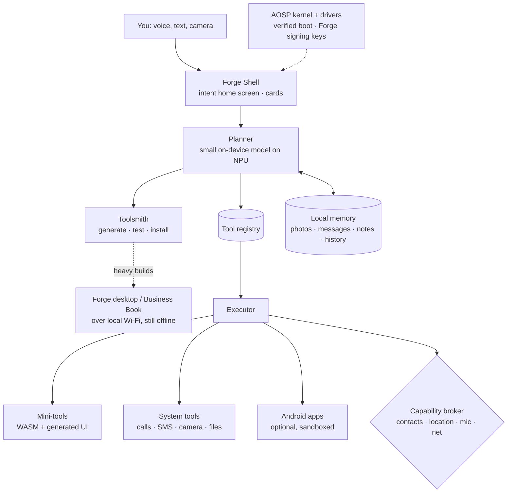

# Forge Mobile: an offline AI phone OS (concept)

> Status: **concept, open for discussion.** Companion to the [Forge desktop concept](README.md). Same idea, now for phones: the device carries its own model, and that model's job is to make and run tools, fully offline.

## The hidden assumption, on phones

A phone today is a grid of apps, each from a different company, each wanting an account and an internet connection, and the "smart" part (assistant, translation, photo search) mostly runs on someone else's servers.

Forge Mobile assumes the opposite:

- **Intent first, not apps first.** You say what you need; the phone finds a tool, combines tools, or builds a new one.
- **Intelligence on the device.** Voice, translation, reading text in photos, search across your own data, and tool-building all work in airplane mode.
- **Calls and SMS still work without data.** "Offline" means no internet dependency, not no phone network.

## Independent, but not from scratch

A complete new phone OS still needs a kernel and drivers. On phones that is the hardest part by far: the modem, camera, GPU and NPU drivers are mostly closed-source and supplied by the chip maker. Every serious alternative phone OS deals with this by reusing a base:

| Base | Examples | Pros | Cons |
|---|---|---|---|
| **AOSP** (open-source core of Android, without Google) | GrapheneOS, /e/OS, LineageOS | Works with existing phone drivers, camera, modem and NPU; can optionally run Android apps; proven security model | Inherits Android's structure; must follow its update cycle |
| **Mainline Linux** | postmarketOS, Ubuntu Touch, Sailfish OS | Fully independent, same base as Forge desktop | Few phones fully supported; cameras, modems and NPUs often half-working; no Android apps without extra layers |

**Recommendation: build on AOSP, replace everything the user sees.** Keep the kernel, drivers and low-level system. Remove all Google services. Replace the launcher, system UI, assistant, settings and permission system with Forge. To the user it is a new OS; underneath, the hard hardware problems are already solved. (This is how GrapheneOS, a respected privacy OS, is built.)

## Architecture

### What runs on the phone
- **On-device models**, quantized and running on the phone's NPU/GPU:
  - a small language model (roughly 1–4B parameters) for planning, chat and simple tool generation,
  - speech-to-text and text-to-speech, including Indian and other regional languages,
  - translation, OCR (reading text from photos and documents), image understanding.
- **Hardware reality:** a recent upper-mid-range or flagship phone (8–16 GB RAM, a modern NPU) can run models of this size at usable speed. Budget phones get a lighter model pack.
- **Battery and heat** are the real limits. Models load only when needed, and long jobs (indexing photos, building a tool) run while charging.

### Tools instead of apps
On the desktop, Forge builds programs. On the phone, it builds **mini-tools**: small, single-purpose screens with a generated interface.

- *"Track which days the milkman didn't come and what I owe at month end."* → a small tracker card on the home screen.
- *"Split tonight's bill between these four people."* → a calculator tool that reads the receipt photo.
- *"Remind me to water the plants when it hasn't rained for three days."* → a rule tool (uses offline weather only if you allow network access).

Each mini-tool has a manifest with declared permissions (same format as desktop), runs in a WASM sandbox, is tested before install, and can be shared with another Forge phone over Bluetooth/Wi-Fi Direct, or exported as a web app that opens in any browser.

### Phone + PC: the offline mesh
A phone model is small. When a request is too hard for it (a complex tool, a long document), the phone can hand the job to a **Forge desktop or Business Book on the same local Wi-Fi**. No internet, no cloud, still private. The result comes back to the phone. Without a PC nearby, the phone does what it can on its own.

### Intent-first home screen
- No app grid by default. The home screen is a **search/voice bar plus cards**: your tools, today's reminders, recent results.
- Ask for anything; Forge shows a matching tool or offers to build one.
- An "All apps" view still exists for people who want it.

## The app problem (the hardest part)

Every new phone OS that failed (Firefox OS, Windows Phone, Ubuntu Touch as a consumer product) failed mainly on one thing: **people need their existing apps.** In India that means WhatsApp, UPI and banking apps, Aadhaar-related services, maps, cab and delivery apps.

Options:

1. **Run Android apps in a sandbox** (possible because the base is AOSP). Many apps work without Google services, or with a sandboxed compatibility layer like the one GrapheneOS uses.
2. **But some apps will refuse to run.** Many banking and payment apps check whether the phone is running Google-certified Android (Play Integrity) and block it otherwise. This is a known problem for every independent Android-based OS and cannot be fully solved by us alone.
3. **Position around it.** Either accept that Forge Mobile is a *second device* or a *work device* for some users, or target markets where those apps matter less (field workers, privacy-focused professionals, organisations issuing devices).

**This needs a clear decision early**, because it shapes who the phone is for.

## Security and privacy
- **Verified boot with Forge's own signing keys**, so the OS can't be silently modified.
- **No Google services, no account required.** No data leaves the phone unless a tool you approved has network permission.
- **Capability permissions per tool** (contacts, location, mic, camera, network), all logged.
- **Generated tools are untrusted** and sandboxed, exactly as on desktop.

## Updates
Phones need regular security patches, including for the modem and kernel, and those come from the chip maker through the phone manufacturer. So:
- Forge must ship on **phones whose manufacturer provides long-term updates**, or partner with a manufacturer directly.
- Updates can install offline: signed update files from SD card, USB, or another Forge device, with automatic rollback if something fails.

## Mobile editions

| Edition | For | Why offline matters |
|---|---|---|
| **Forge Field** | Health workers, farmers, NGOs, rural schools | Poor connectivity; local languages; long battery; rugged body. Strongest case for an offline AI phone. |
| **Forge Private** | Lawyers, doctors, journalists, government and business users | Confidential data must not go to cloud services |
| **Forge Creator** | Short-form video makers | On-device captions, translation, silence cuts and clip picking straight from the camera roll |
| **Forge Everyday** | General consumers | Only once the app-compatibility story is good enough |

## Roadmap sketch

| Phase | Deliverable | Proves |
|---|---|---|
| 0 | Forge shell and on-device models as an app on normal Android | The intent home screen and mini-tools are useful on a phone |
| 1 | **Installable Forge Mobile image** on 1–2 phone models with unlockable bootloaders (e.g. Google Pixel, as GrapheneOS does), Google services removed | It runs as an independent phone OS |
| 2 | Sandboxed Android app support; tool sharing between phones; phone–PC offline mesh | People can live with it daily |
| 3 | Forge Field pilot with an NGO or health programme, on a partner manufacturer's phone | A real group relies on it with no internet |
| 4 | Own Forge phone with a manufacturer (ODM) partner; more editions | A device line |

**First demo:** a phone in airplane mode. Ask, by voice in Hindi, for a tool that tracks daily milk deliveries and totals the monthly bill. It appears on the home screen in under a minute, works, and is sent to a second Forge phone over Bluetooth.

## Risks and honest limits
- **Drivers depend on chip makers.** Without their cooperation, cameras, modems and NPUs may not work fully, and security patches stop.
- **App compatibility**, especially banking and UPI, as described above.
- **Small models on phones are limited.** Mini-tools must stay simple; anything bigger goes to the PC mesh.
- **Battery life** suffers if models run constantly.
- **Hardware business risk:** building a phone is capital-heavy and margins are thin. Starting on existing phones and specific organisations avoids the worst of it.

## Open questions (for discussion)
1. **AOSP or mainline Linux?** Current lean: AOSP for working hardware. Mainline Linux would share more with Forge desktop but works on far fewer phones.
2. **Android app support: yes or no?** Supporting it helps adoption but makes Forge feel like "Android without Google". Not supporting it makes Forge purer but limits who can use it.
3. **Who is the first customer?** Field workers through organisations (clear need, bulk orders) or privacy-focused individuals (enthusiasts who will flash an OS themselves)?
4. **One OS for phone and PC, or two related ones?** Shared tool format and sync either way; the question is how much code they share.
5. **Own phone or partner phones?** Same question as desktop, but harder: phones are far more expensive to design and certify.
